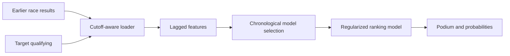

# F1 Predictive Analytics

[](https://github.com/abbasgabol/f1-predictive-analytics/actions/workflows/tests.yml)

**Predicting the podium using information available through qualifying.** A compact machine learning project with ten saved 2026 Grand Prix forecasts, chronological model selection, and reproducible checks for target leakage.

The model combines qualifying position with earlier driver and team form. A shared Python pipeline recreates the original forecasts from local snapshots, without fetching race results or requiring an internet connection.

## Interactive dashboard

**[Open Grid Forecast](https://grid-forecast-f1.vercel.app/)**

Grid Forecast compares saved podium predictions against recorded race classifications, with a qualifying baseline and separate counts for podium membership, winners, and exact orders. Choose a race to see the full grid probabilities. The dashboard has no live data dependency.

Run `python -m http.server 8000 --directory website` and open [localhost:8000](http://localhost:8000). Regenerate the dashboard dataset with `python scripts/export_site.py` after updating the archived inputs.

## What this project demonstrates

| Area | Implementation |
| --- | --- |
| Statistical modeling | Regularized Plackett–Luce ranking with an analytic gradient and probabilistic podium estimates |
| Feature engineering | Lagged driver form, smoothed podium rate, and team form computed strictly from earlier rounds |
| Model evaluation | Expanding-window validation by whole race; nested selection across six small candidate models |
| Data engineering | Deduplicated event snapshots, validated joins, field allowlists, and recorded input hashes |
| Performance | Precomputed historical features, dataset-scoped fit caches, and vectorized exact podium probabilities |
| Reproducibility | Frozen forecasts, automated regression and leakage checks, and GitHub Actions |

**Stack:** Python 3.10+, NumPy, SciPy, `unittest`, GitHub Actions.

## Run a forecast

```bash
git clone https://github.com/abbasgabol/f1-predictive-analytics.git
cd f1-predictive-analytics
python -m venv .venv
```

Activate the environment:

```powershell
# Windows PowerShell
.\.venv\Scripts\Activate.ps1
```

```bash
# macOS / Linux
source .venv/bin/activate
```

Then install the two runtime dependencies and run:

```bash
python -m pip install -r requirements.txt
python -m f1predictor list
python -m f1predictor predict las-vegas --output .runs/las-vegas.json
```

The saved Las Vegas forecast predicts **Kimi Antonelli → Max Verstappen → George Russell**. This is a model prediction, not a statement of the race result. Its selected model is `form_l2_0.03`, fitted on 20 earlier races.

Available race names: `dutch`, `italy`, `spain`, `azerbaijan`, `bahrain`, `singapore`, `united-states`, `mexico`, `brazil`, `las-vegas`.

Fresh output belongs in `.runs/` or another separate folder. The CLI protects the checked-in data and original forecast folders from output overwrites.

## How it works



Each driver receives a score from four numerical features: qualifying quality, recent finishing form, prior podium rate, and recent team form. The ranking model converts those scores into probabilities for every possible ordered podium. With 22 entrants, it evaluates all **9,240** distinct three-driver combinations.

The Dutch and Italian snapshots retain the original fixed model. Later snapshots select between qualifying-only and four-feature models, each with three regularization strengths. Selection uses earlier races only and a one-standard-error heuristic favoring simpler models. The [methodology](docs/methodology.md) describes the equations and validation boundaries.

## Measured performance

The [frozen Las Vegas report](forecasts/las-vegas/REPORT.md) records these retrospective chronological checks. Each test fits on earlier rounds and evaluates the next race; model selection is repeated inside each training window.

| Measure | Recorded result |
| --- | ---: |
| Earlier races available for final fitting | 20 races / 440 driver entries |
| Outer validation races | 14, rounds 7–20 |
| Mean correctly identified podium drivers, ignoring order | 1.93 out of 3 |
| Correct race winners | 8 out of 14 |
| Exact ordered podiums | 0 out of 14 |
| Mean ordered-podium negative log-likelihood ↓ | 5.420 |

These are **retrospective development checks**, not a new untouched benchmark or a claim of future accuracy. The dataset is small, and probabilities have not been calibrated. Correctly naming three podium drivers on one occasion does not establish generalization or prove absence of leakage. The goal is credible performance on future races; test scores need not exceed training scores.

## Check reproducibility and leakage safeguards

```bash
# Unit tests, including temporal boundaries and probability calculations
python -m unittest discover -s tests -v

# Check recorded data and frozen-artifact hashes
python -m f1predictor verify

# Recompute all ten forecasts and their historical backtests
python -m f1predictor verify --replay

# Or inspect one race
python -m f1predictor verify --replay --race las-vegas
python -m f1predictor backtest las-vegas
```

- The prediction loader opens only earlier results and the target qualifying file. It does not open the target result file, even when that file is present for a later forecast's history.
- Feature construction enforces `historical_round < prediction_round`, including for training examples.
- Target inputs accept only qualifying fields; unexpected fields and incomplete or mismatched entrants fail validation.
- Tests exercise future-label poisoning, identity anonymization, independent probability calculations, numerical gradients, cache isolation, and reproduction of saved forecasts.
- Hash checks detect changes relative to the recorded snapshots. They do not independently certify when the source information became available.

Earlier investigations are preserved in [docs/audits](docs/audits). Their file paths and claims describe the implementation at the time of those investigations.

## Repository layout

```text
f1predictor/          Shared loader, features, ranking, validation, and CLI
data/
  catalog.json       Race names, cutoffs, selection policy, and input hashes
  manifest.json      Checksums for data and frozen artifacts
  events/01...21/    Qualifying snapshots; earlier race classifications
forecasts/
  <race-name>/       Original prediction, model, report, and provenance
docs/
  methodology.md     Model design and evaluation
  data-card.md       Data origin, processing, and limitations
  audits/            Preserved earlier investigations
  benchmark.json     Recorded local runtime comparison
tests/               Behavioral, leakage, and regression checks
.github/workflows/   Automated reproducibility checks
```

Each race keeps its own named forecast folder while sharing one implementation and one event store. Original forecast artifacts are retained; new runs are written separately.

## Optimization with reproducibility

Historical feature matrices are computed once per training snapshot. Repeated fits and validation scores are cached within that snapshot and cutoff, and all ordered podium probabilities are computed with NumPy arrays. Regression checks compare the refactored coefficients, probabilities, podiums, and backtests with the frozen originals.

A [recorded local comparison](docs/benchmark.json) measured **10.682 s → 7.242 s**, or **1.48× faster**, for the Las Vegas fit, selection, and backtest. This was one cold-process run per implementation on one machine; the new run also verified frozen artifacts. It is an indicative measurement, not a portable performance guarantee.

## Data transparency

The snapshots combine a user-provided historical workbook and subsequently collected classifications; source references and processing notes remain with each forecast. Retrospectively retrieved pages may contain later corrections, so these are not independently certified snapshots of what was published at qualifying time.

The Italian forecast's provenance also records that a search incidentally exposed a race-result snippet to the assistant. That result was excluded from the model inputs, but the forecast is not claimed to have been fully blind.

The project models qualifying and recent form. It does not model live race telemetry, pit stops, race-day weather, reliability, or circuit-specific pace. Read the [data card](docs/data-card.md) before interpreting the forecasts or extending the dataset.
